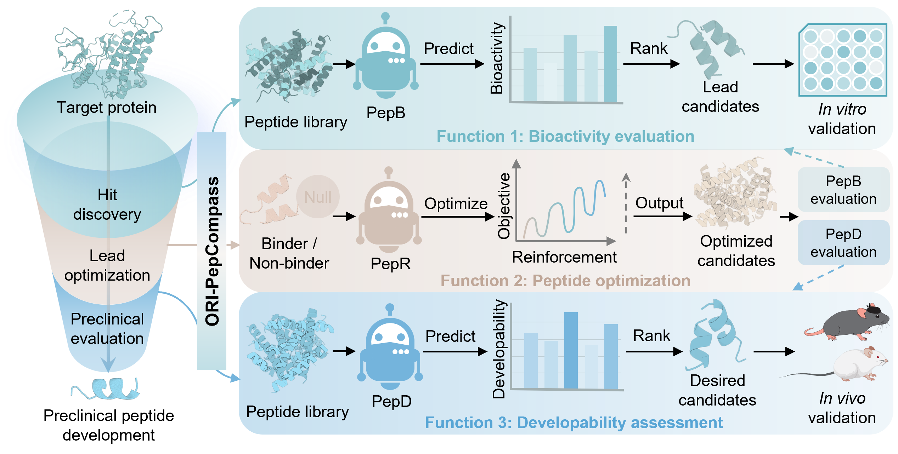

# ORI-PepCompass

ORI-PepCompass is an AI toolkit that integrates cross-domain knowledge transfer, self-distillation, and reinforcement learning for peptide bioactivity prediction, developability assessment, and sequence optimization. It comprises three modules:

- **PepB** — bioactivity prediction (in vitro protein–peptide activity).
- **PepD** — multi-attribute developability assessment (e.g., allergenicity, half-life, hemolysis, non-fouling, permeability, solubility, stability, and toxicity).
- **PepR** — reinforcement learning-based peptide optimization and de novo generation.




## Installation and Setup

1. **Hardware requirements**:
   This project requires only a standard computer with enough RAM and a NVIDIA GPU to support operations. We ran the demo using the following specs:
   - CPU: 10 cores, 2.5 GHz/core
   - RAM: 40GB
   - GPU: NVIDIA TESLA P40, V100, A100
   - CUDA: 11.0

2. **System requirements**:
   This tool is supported for Linux. The tool has been tested on the following system:

   - CentOS Linux release 8.2.2.2004

3. **Clone the Repository**:
   ```bash
   git clone https://github.com/TencentAI4S/ori.git
   cd ori/projects/ORI-PepCompass
   ```

4. **Install Required Packages**:
   The basic environment requirements are:
   - Python: 3.10
   - CUDA: 11.0

   Use the following command to install the necessary packages as specified in the `requirements.txt` file:

   ```bash
   conda create -n ORI-PepCompass python==3.10
   conda activate ORI-PepCompass
   pip install -r requirements.txt
   ```

5. **Download Model Weights**:

   Download the `model_weights.zip` file and extract it to the `ORI-PepCompass/model_weights` directory. The model_weights.zip is available on Hugging Face: <https://huggingface.co/DDDead/ORI-PepCompass/tree/main>

   After extraction, the `ORI-PepCompass/model_weights` directory should contain the following:

   ```plaintext
   ORI-PepCompass/model_weights/
   ├── ESM-2/
   ├── ESM-Pep/
   ├── PepD/
   ├── PepB/
   └── PepB_pmhc
   ```

6. **Download PDBBind Data**:

   Download the `pdbbind_data.zip` file and extract it to the `ORI-PepCompass/PepB` directory, specifically to `ORI-PepCompass/PepB/pdbbind_data`. The pdbbind_data.zip is available on Zenodo: <https://doi.org/10.5281/zenodo.21695792>

   After extraction, the `ORI-PepCompass/PepB/pdbbind_data` directory should contain the following:

   ```plaintext
   ORI-PepCompass/PepB/pdbbind_data/
   ├── all_data.tsv
   ├── pep/
   └── pro/
   ```

7. **Download Antigen-HLA Data**:

   Download the `pmhc_data.zip` file and extract it to the `ORI-PepCompass/PepB` directory, specifically to `ORI-PepCompass/PepB/pmhc_data`. The pmhc_data.zip is available on Zenodo: <https://doi.org/10.5281/zenodo.21695792>

   After extraction, the `ORI-PepCompass/PepB/pmhc_data` directory should contain the following:

   ```plaintext
   ORI-PepCompass/PepB/pmhc_data/
   ├── test_data.tsv
   ├── mhc/
   └── pep/
   ```
  
8. **Download Receptor Data**:

   Download the `receptor_data.zip` file and extract it to the `ORI-PepCompass/PepB` directory, specifically to `ORI-PepCompass/PepB/receptor_data`. The receptor_data.zip is available on Zenodo: <https://doi.org/10.5281/zenodo.21695792>

   After extraction, the `ORI-PepCompass/PepB/receptor_data` directory should contain the following:

   ```plaintext
   ORI-PepCompass/PepB/receptor_data/
   ├── coordinates.json
   ├── mod_rec_seq.json
   ├── rec_interface.json
   ├── supported_receptor_pdbid.txt
   └── esm/
   ```

---

## Quick Start
   To quickly get started with ORI-PepCompass, you can use the provided automation script. Follow these steps:

1. **Run the Automation Script**:
   After setting up the environment and downloading the necessary files, you can run the automation script to start an example task easily.

      ```bash
      python quick_start.py
      ```
   This will present you with a menu to select from the following options:

   ```
    Welcome to the automation script for ORI-PepCompass: bioactivity prediction, developability assessment, and peptide optimization!

    Please choose an option:
    1. Run PepB bioactivity prediction for PDBbind
    2. Run PepB bioactivity prediction for single pair
    3. Run PepB bioactivity prediction for antigen-HLA
    4. Run PepD developability assessment (single peptide)
    5. Run PepD developability assessment (batch)
    6. Run PepR peptide evolution
    7. Exit
    Enter your choice (1-7):
   ```

   1. **Run PepB bioactivity prediction for PDBbind**
   - Select option 1 allows you to perform a binding affinity prediction for the PDBBind dataset.
   ```
   Enter your choice (1-7): 1
   Running command: cd PepB && python predict.py --task pdbbind
   Results were saved in PepB/output/pdbbind.tsv
   ```
   2. **Run PepB bioactivity prediction for single pair**
   - Selection option 2 allows you to perform a binding affinity prediction for a given protein and a peptide. If you want to specify parameters such as the target protein and the peptide sequence, please refer to Further instructions 2.
   ```
    Enter your choice (1-7): 2
    Running command: cd PepB && python predict.py --task single
    Starting prediction for protein: 5yqz_R, peptide: HSQGTFTSDYSKYLDSERAQEFVQWLENE
    Dataset created.
    Models loaded successfully.
    Predicted binding affinity between 5yqz_R and HSQGTFTSDYSKYLDSERAQEFVQWLENE: 10.12
   ```

   3. **Run PepB bioactivity prediction for antigen-HLA**
   - Selection option 3 allows you to perform a binding affinity prediction for the antigen-HLA test data. If you want to specify parameters such as the input data, please refer to Further instructions 3.
   ```
   Enter your choice (1-7): 3
   Running command: cd PepB && python predict.py --task pmhc
   Building data ...
   Predicting...
   Results were saved in PepB/output/pmhc.tsv
   ```

   4. **Run PepD developability assessment (single peptide)**
   - Selection option 4 allows you to perform a unified 9-property developability assessment for a single peptide sequence. The prediction covers allergenicity, half-life (in vitro/in vivo), hemolysis, non-fouling, permeability, solubility, stability, and toxicity.
   ```
   Enter your choice (1-7): 4
   Running command: cd PepD && python predict.py --sequence GSPLRYQWTIDYKGR --gpu 0
   [predict] Loading ESM2 from .../model_weights/ESM-2 on cuda:0
   ...
   Property              d  Task              Description
   ------------------------------------------------------------
   allergen          0.9440  classification     non-allergenic
   halflife_invitro  0.5187  regression         long in-vitro half-life
   halflife_invivo   0.4332  regression         long in-vivo half-life
   hemolysis         0.8592  classification     non-hemolytic
   nonfouling        0.2478  classification     non-fouling
   permeability      0.7868  classification     high permeability
   solubility        0.3899  classification     high solubility
   stability         0.3679  regression         high stability
   toxicity          0.8477  classification     non-toxic
   ```

   5. **Run PepD developability assessment (batch)**
   - Selection option 5 allows you to perform batch developability assessment from a TSV/CSV file. Each peptide's 9 property scores are written to the output file.
   ```
   Enter your choice (1-7): 5
   Running command: cd PepD && python predict.py --input peptides.txt --output scored.tsv --gpu 0
   [predict] 6/6 scored, wrote → scored.tsv
   ```

   6. **Run peptide evolution**
   - Select option 6 will start the Reinforcement Learning (RL) optimization process. This process will optimize the given peptide sequence targeting a specific protein (pdb id) to search better mutated sequences with higher predicted bioactivity. If you want to specify parameters such as the target protein and the initial peptide sequence, please refer to Further instructions 6.
   ```
    Enter your choice (1-7): 6
    Running command: cd PepR && sh run.sh
    Target PDB: 7lll_R, Start sequence: TFQKWAAVVVPSG
    ################## model loaded on cuda #####################
    ######### 1-th Play ###########
    Mutated seq TFRKWAAVVVPSG
    ...
   ```

   7. **Exit:**
   - Choosing this option will exit the script and terminate the current session.

   Simply enter the corresponding number to execute your desired task.

---

## Further Instructions
### 1. Run PepB bioactivity prediction for PDBbind

Navigate to the `PepB` directory and run the example code:
```bash
cd ORI-PepCompass/PepB
python predict.py --task pdbbind
```
This will utilize five models to predict the final results.


### 2. Run PepB bioactivity prediction for single pair

A list of supported PDB IDs (35,473) can be found in `ORI-PepCompass/PepB/receptor_data/supported_receptor_pdbid.txt`.

Since PepB requires various features for prediction, we support an approach to simply use PepB:

Use the built-in feature extraction by specifying the target PDB ID and peptide sequence in `predict.py`:
```bash
cd ORI-PepCompass/PepB
python predict.py --task single
```

### 3. Run PepB bioactivity prediction for antigen-HLA
Navigate to the `PepB` directory and run the example code:

```bash
cd ORI-PepCompass/PepB
python predict.py --task pmhc
```

If you want to test self-data, please use AlphaFold2 to predict the complete HLA structure, and use ESM2 and ESM-pep to extract evolutionary embeddings for HLA and antigen sequences.

### 4. Run PepD developability assessment (single peptide)

Predict 9 property desirability scores from a peptide sequence. Navigate to the `PepD` directory and run:

```bash
cd ORI-PepCompass/PepD
python predict.py --sequence "GSPLRYQWTIDYKGR" --gpu 0
```

The 9 properties (all d ∈ [0,1], higher = better):
- **allergen**: non-allergenic probability
- **halflife_invitro**: in-vitro half-life desirability
- **halflife_invivo**: in-vivo half-life desirability
- **hemolysis**: non-hemolytic probability
- **nonfouling**: non-fouling probability
- **permeability**: high permeability probability
- **solubility**: high solubility probability
- **stability**: peptide stability desirability
- **toxicity**: non-toxic probability

Customize GPU with `--gpu N`, or use `--gpu cpu` for CPU-only inference. Set `--warmup` to preload all checkpoints at startup.

### 5. Run PepD developability assessment (batch)

Score multiple peptides from a TSV/CSV file with columns `name` and `sequence`:

```bash
cd ORI-PepCompass/PepD
python predict.py --input candidates.tsv --output scored.tsv --gpu 0
```

The output TSV contains all 9 `d_<property>` columns plus `name`, `sequence`, and `length`.

Use `--ckpt_root /path/to/weights` if model weights are in a custom location. Default is `../model_weights/PepD/`.

### 6. Run peptide evolution

Navigate to the `PepR` directory and run the optimization script:
```bash
cd ORI-PepCompass/PepR
sh run.sh
```

#### Key Parameter Explanations:
- `PLAYOUT_NUM=20`: The number of rounds for each game.
- `NITER=100`: The number of optimization iterations.
- `WORKDIR='./'`: The working directory.
- `PDBID='7lll_R'`: The PDB ID of the target protein.
- `SEQ='QDEEGLLLMQSLEMS'`: The peptide sequence to be optimized.
- `OUTPUT_DIR="./results/${PDBID}/${SEQ}"`: The directory for output results.

A list of supported PDB IDs can be found in `ORI-PepCompass/PepB/receptor_data/supported_receptor_pdbid.txt`.
