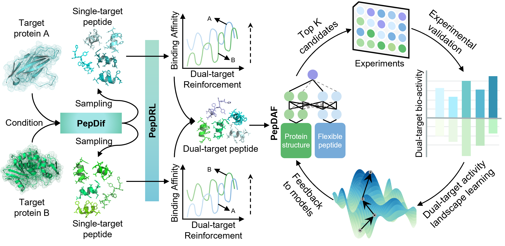

```markdown
# ORIDTP

ORIDTP is a toolkit for de novo dual-target peptide generation, mutation optimization, and protein-peptide affinity prediction. This project includes multiple modules for different tasks.
```


## Installation and Setup

1. **Hardware requirements**:
   This project requires only a standard computer with enough RAM and a NVIDIA GPU to support operations. We ran the demo using the following specs:
   - CPU: 10 cores, 2.5 GHz/core
   - RAM: 40GB
   - GPU: NVIDIA TESLA P40, V100, A100
   - CUDA: 11.0

2. **System requirements**:
   This tool is supported for Linux. The tool has been tested on the following system:

   - CentOS Linux release 8.2.2.2004

3. **Clone the Repository**:
   ```bash
   git clone https://github.com/TencentAI4S/ori.git
   cd ori/projects/oridtp
   ```

4. **Install Required Packages**:
   The basic environment requirements are:
   - Python: 3.10
   - CUDA: 11.0

   Use the following command to install the necessary packages as specified in the `requirements.txt` file:

   ```bash
   conda create -n ORIDTP python==3.10
   conda activate ORIDTP
   pip install -r requirements.txt
   ```

5. **Download Model Weights**:

   Download the `model_weights.zip` file and extract it to the `ORIDTP/model_weights` directory. The model_weights.zip is available on Zenodo: <https://doi.org/10.5281/zenodo.15597537>

   After extraction, the `ORIDTP/model_weights` directory should contain the following:

   ```plaintext
   ORIDTP/model_weights/
   ├── ESM-2/
   ├── ESM-Pep/
   ├── PepAF/
   └── PepDif/
   ```
   
6. **Download Receptor Data**:

   Download the `receptor_data.zip` file and extract it to the `ORIDTP/PepDAF` directory, specifically to `ORIDTP/PepDAF/receptor_data`. The receptor_data.zip is available on Zenodo: <https://doi.org/10.5281/zenodo.15597537>

   After extraction, the `ORIDTP/PepDAF/receptor_data` directory should contain the following:

   ```plaintext
   ORIDTP/PepDAF/receptor_data/
   ├── coordinates.json
   ├── mod_rec_seq.json
   ├── rec_interface.json
   ├── supported_receptor_pdbid.txt
   └── esm/
   ```
---

## Quick Start
   To quickly get started with ORIDTP, you can use the provided automation script. Follow these steps:

1. **Run the Automation Script**:
   After setting up the environment and downloading the necessary files, you can run the automation script to start an example task easily.

      ```bash
      python run_oridtp.py
      ```
   This will present you with a menu to select from the following options:
   ```
   Welcome to the ORIDTP automation script!

   Please choose an option:
    1. Run PepDif generation (Generic model)
    2. Run PepDif generation (GLP1R&GCGR enhanced model)
    3. Run PepDRL optimization
    4. Run single prediction in PepDAF
    5. Run batch prediction in PepDAF
    6. Exit
   Enter your choice (1-6):
   ```

   1. **Run PepDif generation (Generic model)**
   - Select option 1 will initiate the PepDif model (Generic type) to generate diverse peptide sequences for given target proteins. This model leverages conditional diffusion and self-distillation techniques to produce peptide sequences with potential biological activity. If you want to specify parameters such as the input protein sequence, please refer to Further instructions 1.
   ```
   Enter your choice (1-6): 1
   Running command: cd PepDif/scripts && sh run_decode.sh
    ### Creating model and diffusion...
    ### The parameter count is 87416936
    ### Sampling...on test
    ...
    ### Total takes 249.90s .....
    ### Written the decoded output to generation_outputs_1/PepDif/seed123_step0.json
   ```
   2. **Run PepDif generation (GLP1R&GCGR enhanced model)**
   - Select option 2 will initiate the PepDif model (GLP1R&GCGR enhanced type) to generate diverse peptide sequences for GLP1R and GCGR. This model was further enhanced with virtual feedback on GLP-1R/GCGR targets.
   ```
   Enter your choice (1-6): 2
   Running command: cd PepDif/scripts && sh run_decode_glp1rgcgr.sh
    ### Creating model and diffusion...
    ### The parameter count is 87416936
    ### Sampling...on test
    ...
    ### Total takes 169.21s .....
    ### Written the decoded output to generation_outputs_glp1rgcgr_1/PepDif/seed123_step0.json
   ```

   3. **Run PepDRL optimization**
   - Select option 3 will start the dual-target Reinforcement Learning (RL) optimization process. This process will optimize the given peptide sequence targeting two specific proteins (pdb id) to search better mutated sequences with higher affinity. If you want to specify parameters such as the target protein and the initial peptide sequence, please refer to Further instructions 2.

   ```
   Enter your choice (1-6): 3
   Running command: cd PepDRL && sh run.sh
   Target PDB: 7lll_R and 5yqz_R, Start sequence: HSQGTFTSDYSKYLDSQGRDFVQWLWLAGG
   The current date and time is ...
   ################## model loaded on cuda #####################
   ######### 1-th Play ###########
   Mutated seq HSQGTFTSDYSKYLDSQPRDFVQWLWLAGG
   ######### 2-th Play ###########
   Mutated seq HSQGTFTSDYSKYLDSQGRDFVQTLWLAGG
   ...
   Output directory: 
   ./results/7lll_R+5yqz_R/HSQGTFTSDYSKYLDSQGRDFVQWLWLAGG
   ```

   4. **Run single prediction in PepDAF**
   - Selection option 4 allows you to perform a binding affinity for a given protein and a peptide. If you want to specify parameters such as the target protein and the peptide sequence, please refer to Further instructions 3.
   ```
   Enter your choice (1-6): 4
   Running command: cd PepDAF && python predict.py --task single
   Starting prediction for protein: 3dab_G, peptide: TSFAEYWNLLSP
   Dataset created.
   Models loaded successfully.
   Predicted binding affinity between 3dab_G and TSFAEYWNLLSP: 7.570078659057617
   ```

   5. **Run batch prediction in PepDAF**
   - Selection option 5 allows you to conduct batch predictions for multiple peptide sequences. This is particularly useful when you need to asess a large number of peptide sequences simultaneously. If you want to specify parameters such as the target protein and the peptide sequences, please refer to Further instructions 3.
   ```
   Enter your choice (1-6): 5
   Running command: cd PepDAF/utils/preprocess && sh start.sh
   Starting the process...
   Creating DataFrame...
   DataFrame created successfully.
   Adding SMILES data...
   Converting peptide TSV to JSON...
   Converting peptides to FASTA format...
   Creating directory for IDs...
   Changing directory to ../iupred...
   Calculating matrix...
   Merging results...
   Merging completed successfully.
   Extracting peptide embeddings...
   Extracting protein embeddings...
   Process completed successfully.
   Running command: cd PepDAF && python predict.py --task batch
   Results have been saved in PepDAF/output/batch.tsv
   ```

   6. **Exit:**
   - Choosing this option will exit the script and terminate the current session.
   ```
   Enter your choice (1-6): 6
   Exiting the script.
   ```
   Simply enter the corresponding number to execute your desired task.


---

## Further Instructions
### 1. Generate New Peptides Using PepDif

Navigate to the `PepDif/scripts` directory.
If you want to use the generic model, please run the example code:
```bash
cd PepDif/scripts
sh run_decode.sh
```
The target protein sequences can be changed in `PepDif/pepdif/example/test.jsonl`

If you want to use the GLP1R/GCGR enhanced model, please run the example code:
```bash
cd ORIDTP/PepDif/scripts
sh run_decode_glp1rgcgr.sh
```

#### Key Parameter Explanations:
- `--model_path`: The trained model path.
- `--seed`: The random seed.
- `--top_p`: The top p to sample.
- `--step`: The sampling step.
- `--bsz`: The batch size.

### 2. Optimize Peptide Mutations Using PepDRL and PepDAF

Navigate to the `PepRL` directory and run the optimization script:
```bash
cd ORIDTP/PepDRL
sh run.sh
```

#### Key Parameter Explanations:
- `PLAYOUT_NUM=20`: The number of rounds for each game.
- `NITER=100`: The number of optimization iterations.
- `WORKDIR='./'`: The working directory.
- `PDBID='7lll_R'`: The PDB ID of the first target protein.
- `SECOND_PDBID='5yqz_R'`: The PDB ID of the second target protein.
- `SEQ='HSQGTFTSDYSKYLDSQGRDFVQWLWLAGG'`: The peptide sequence to be optimized.
- `OUTPUT_DIR="./results/${FIRST_PDBID}+${SECOND_PDBID}/${SEQ}"`: The directory for output results.

A list of supported PDB IDs can be found in `ORIDTP/PepDAF/receptor_data/supported_receptor_pdbid.txt`.

### 3. Predict Protein-Peptide Affinity Using PepDAF

A list of supported PDB IDs can be found in `ORIDTP/PepDAF/receptor_data/supported_receptor_pdbid.txt`.

Since PepDAF requires various features for prediction, we support two approaches to use PepDAF:

#### 3.1 Single Protein-Peptide Prediction

Use the built-in feature extraction by specifying the target PDB ID and peptide sequence in `predict.py`:
```bash
cd ORIDTP/PepDAF
python predict.py --task single
```

#### 3.2 Batch Calculation for Single Protein and Multiple Peptides

First, navigate to the feature extraction directory and run:
```bash
cd ORIDTP/PepDAF/utils/preprocess
sh start.sh
```
You can modify the `target.txt` and `peptide.txt` files to set the target and peptide sequences.

Then, return to the `PepDAF` directory and run batch prediction:
```bash
cd ORIDTP/PepDAF
python predict.py --task batch
```

---

## Case Study: Applying ORIDTP to another Dual-Target Pair

ORIDTP is not restricted to GLP-1R/GCGR; that pair is only the default example shipped in the
run scripts. This section walks through a complete campaign (generation -> reinforcement
optimization -> screening) for another pair of targets, denoted `TargetA` and `TargetB`.
Both can be any two receptor PDB IDs listed in
`PepDAF/receptor_data/supported_receptor_pdbid.txt` (the shipped example uses `7lll_R` for
GLP-1R and `5yqz_R` for GCGR).

Note that the dual-target objective is not introduced during generation: PepDif is conditioned
on a single receptor, while the two targets are combined in the PepDRL reward and evaluated
separately during PepDAF screening.

### Step 0: Retrieve the two receptor sequences

For any supported PDB ID, the receptor sequence is already available in the downloaded
receptor data, so no external lookup is required:

```python
import json

receptors = json.load(open('PepDAF/receptor_data/mod_rec_seq.json'))
print(receptors['TargetA'])
print(receptors['TargetB'])
```

### Step 1: Generate candidate peptides for each target (PepDif)

Create one input file per target under `PepDif/pepdif/example/`, named `<split>.jsonl`. Each
line conditions one generated peptide on the given receptor sequence, so repeat the line as
many times as the number of candidates you want:

`PepDif/pepdif/example/test_TargetA.jsonl`
```
{"src": "<sequence of TargetA>", "trg": "X"}
{"src": "<sequence of TargetA>", "trg": "X"}
...
```

Then decode with the **generic** model for each target:

```bash
cd PepDif/scripts
python -u run_decode.py --model_path ../model_weights/PepDif/PepDif.pt \
    --seed 0 --split test_TargetA --top_p -1 --step 2000 --bsz 60
python -u run_decode.py --model_path ../model_weights/PepDif/PepDif.pt \
    --seed 0 --split test_TargetB --top_p -1 --step 2000 --bsz 60
```

The `--split` argument selects `pepdif/example/<split>.jsonl` and results are written to a
split-specific directory, e.g. `PepDif/generation_outputs_test_TargetA_-1/PepDif/seed0_step0.json`,
so runs for different targets do not overwrite each other. The output holds one JSON object per
line, with the generated peptide in `recover` and the conditioning receptor in `source`:

```
{"recover": "<generated peptide>", "source": "<sequence of TargetA>"}
```

Important: use the generic checkpoint `PepDif.pt` for new targets. The checkpoint
`PepDif_glp1rgcgr.pt` was further enhanced with virtual feedback on GLP-1R/GCGR and is
specific to that pair.

### Step 2: Dual-target optimization (PepDRL)

`--pdbid` and `--dual_pdbid` define the reward, while `--start_sequence` defines where the
search begins. All runs below use the same dual-target reward and differ only in their starting
sequence, so the four resulting candidate sets are simply pooled and compared in Step 3:

| Run | Starting sequence |
| --- | --- |
| A | a peptide generated for TargetA |
| B | a peptide generated for TargetB |
| A+B | the TargetA peptide followed by the TargetB peptide |
| B+A | the TargetB peptide followed by the TargetA peptide |

Build the four starting sequences from the Step 1 outputs:

```python
import json

def load_generated(path):
    with open(path) as f:
        return [json.loads(line)['recover'] for line in f if line.strip()]

pep_a = load_generated('PepDif/generation_outputs_test_TargetA_-1/PepDif/seed0_step0.json')[0]
pep_b = load_generated('PepDif/generation_outputs_test_TargetB_-1/PepDif/seed0_step0.json')[0]

linker = 'GGGGS'
fused_ab = pep_a + linker + pep_b
fused_ba = pep_b + linker + pep_a

# 1-based positions occupied by the linker in each fused sequence
linker_ab = f'{len(pep_a) + 1}-{len(pep_a) + len(linker)}'
linker_ba = f'{len(pep_b) + 1}-{len(pep_b) + len(linker)}'
```

A linker is optional; the two peptides can also be joined directly. Since a fused sequence is
longer than either peptide alone, trimming each part to its core binding region keeps the
candidate close to the length range of the peptides seen during training (roughly 12-30
residues); the boundaries are chosen by the user.

Run each starting sequence against the dual-target reward:

```bash
cd PepDRL
# single generated peptide as the starting point
python train.py --pdbid TargetA --dual_pdbid TargetB \
    --start_sequence TSFAEYWNLLSP \
    --n_playout 20 --niter 100 --batch_size 1 --jumpout 32 --c_puct 0.5 \
    --output_dir ./results/TargetA+TargetB/pep_a

# fused starting point, e.g. TSFAEYWNLLSP + GGGGS + ETFSDLWKLLPE (29 residues)
python train.py --pdbid TargetA --dual_pdbid TargetB \
    --start_sequence TSFAEYWNLLSPGGGGSETFSDLWKLLPE \
    --fixed_positions '13-17' \
    --n_playout 20 --niter 100 --batch_size 1 --jumpout 32 --c_puct 0.5 \
    --output_dir ./results/TargetA+TargetB/fused_ab
```

Repeat for `pep_b` and for `fused_ba`. Setting `--pdbid` and `--dual_pdbid` to the same ID
reduces the reward to a single target, which is useful for single-target reference runs.

`--fixed_positions` keeps chosen residues from being mutated, which is convenient for holding a
linker or known anchor residues in place. It takes 1-based positions and ranges, e.g. `'13-17'`
or `'1,4,13-17'`, and also constrains the random-restart mechanism so protected residues survive
the whole run. All positions are mutable when the option is omitted.

#### Reward weighting and output

The dual-target reward is `lam * y(pdbid) + (1 - lam) * y(dual_pdbid)`, where `y` is the
predicted affinity. `--lam` defaults to `0.5`, i.e. both targets are weighted equally and the
reward is symmetric in the two targets. Use `--lam` to prioritize one target, for example
`--lam 0.7` to favour `--pdbid` over `--dual_pdbid`.

Results are written to `<output_dir>/Move_and_playout.csv` with one row per evaluated peptide:

| Column | Meaning |
| --- | --- |
| `peptide` | the evaluated sequence |
| `loss` | reciprocal of the combined dual-target score (`1 / y`), so **lower is better** |
| `losses_A` | reciprocal of the predicted affinity for `--pdbid` |
| `losses_B` | reciprocal of the predicted affinity for `--dual_pdbid` |

Because the columns are reciprocals, rank candidates in ascending order; the predicted
affinity is recovered as `1 / loss`.

### Step 3: Batch screening of the optimized candidates (PepDAF)

Pool the best peptides from all Step 2 runs into a single batch input, so that candidates from
the different starting points are compared on the same footing:

```python
import glob
import pandas as pd

frames = [pd.read_csv(path) for path in
          glob.glob('PepDRL/results/TargetA+TargetB/*/Move_and_playout.csv')]
pooled = pd.concat(frames).drop_duplicates('peptide')
top = pooled.sort_values('loss').head(50)   # lower loss = higher predicted affinity
top['peptide'].to_csv('PepDAF/utils/preprocess/peptide.txt', index=False, header=False)
```

List **both** receptors in `PepDAF/utils/preprocess/target.txt`, one per line, so that every
peptide is scored against both targets in a single run:

```
TargetA
TargetB
```

Then extract features and predict:

```bash
cd PepDAF/utils/preprocess
sh start.sh
cd ../..
python predict.py --task batch
```

`PepDAF/output/batch.tsv` contains one row per (target, peptide) pair, where `pro_name` is the
receptor, `pep_seq` the peptide and `y_pred` the predicted affinity (higher is better). Pivot
it to rank candidates by dual-target criteria:

```python
import pandas as pd

df = pd.read_csv('PepDAF/output/batch.tsv', sep='\t')
wide = df.pivot_table(index='pep_seq', columns='pro_name', values='y_pred')
wide['weakest'] = wide[['TargetA', 'TargetB']].min(axis=1)          # dual-target potency
wide['gap'] = (wide['TargetA'] - wide['TargetB']).abs()             # balance between targets
print(wide.sort_values('weakest', ascending=False).head(20))
```

Ranking by `weakest` favours peptides that bind both targets well, while a small `gap`
indicates a balanced dual-target profile.

### Adding a receptor that is not in the supported list

A receptor is defined by a few per-ID entries in `PepDAF/receptor_data/`. To register a new
receptor `<new_id>`, add:

1. `mod_rec_seq.json`: `"<new_id>": "<receptor sequence>"`.
2. `coordinates.json`: `"<new_id>": {"N": [...], "CA": [...], "C": [...], "O": [...]}`, the
   backbone coordinates taken from the receptor structure.
3. `rec_interface.json`: `"<new_id>": [...]`, the binding-interface (epitope) residues.
4. `esm/<new_id>.pt`: add `<new_id>` to `PepDAF/utils/preprocess/target.txt` and run
   `python extract_pro_esm.py`. This step is optional, as the embedding is computed on the fly
   when the file is absent.
5. `supported_receptor_pdbid.txt`: append `<new_id>`.

The new ID can then be used anywhere `TargetA`/`TargetB` appear above, with no code changes.

### Notes

- `run_oridtp.py` runs the shipped GLP-1R/GCGR example; use the commands in this section to
  work with other targets.
- Receptor IDs follow the `<pdb>_<chain>` convention and are split on the underscore during
  batch preprocessing, so keep exactly one underscore in each ID.
- `--lam` and `--fixed_positions` both default to the previous behaviour (equal weighting of the
  two targets and no positional constraints), so existing commands are unaffected.